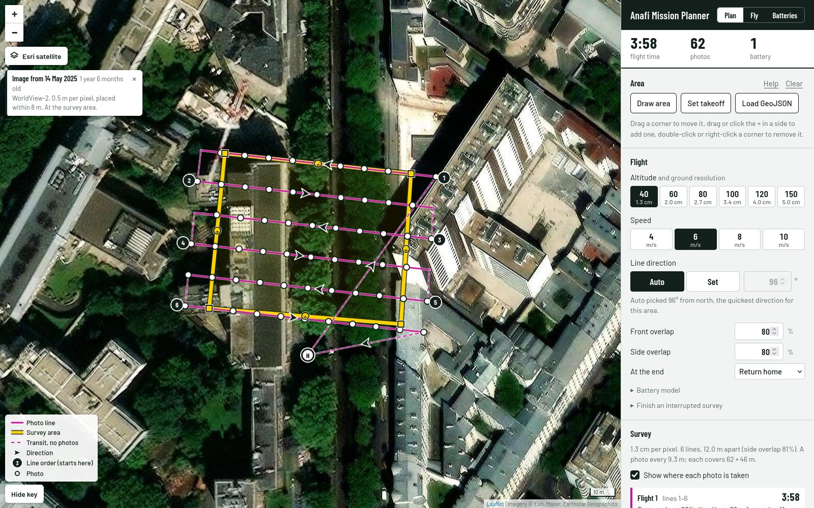
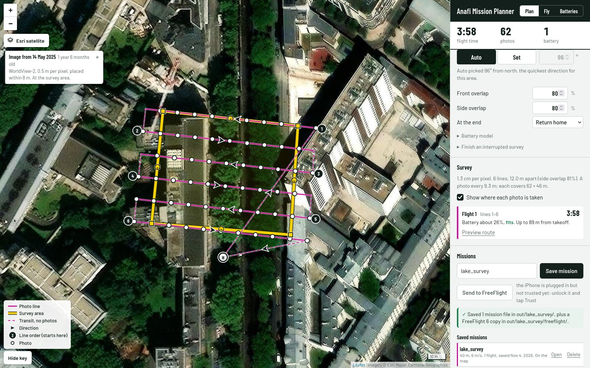
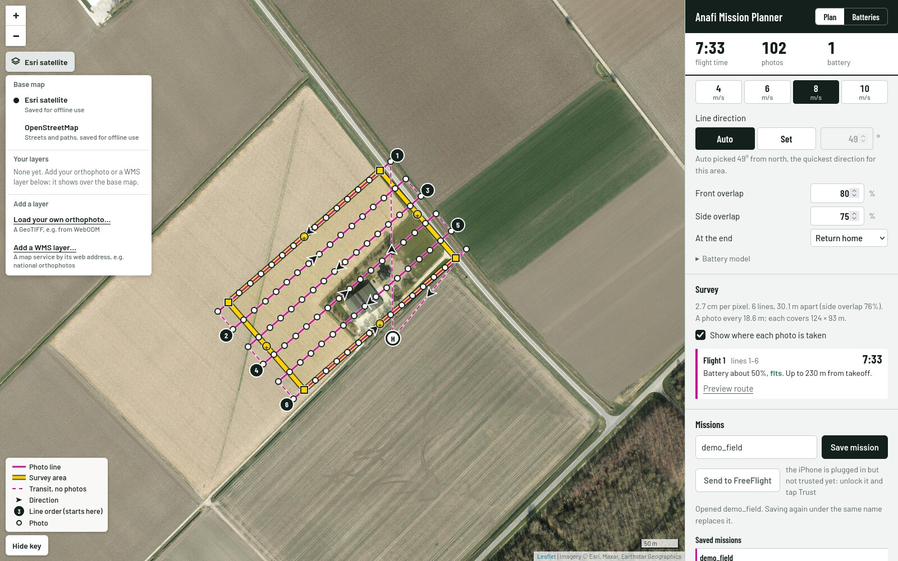
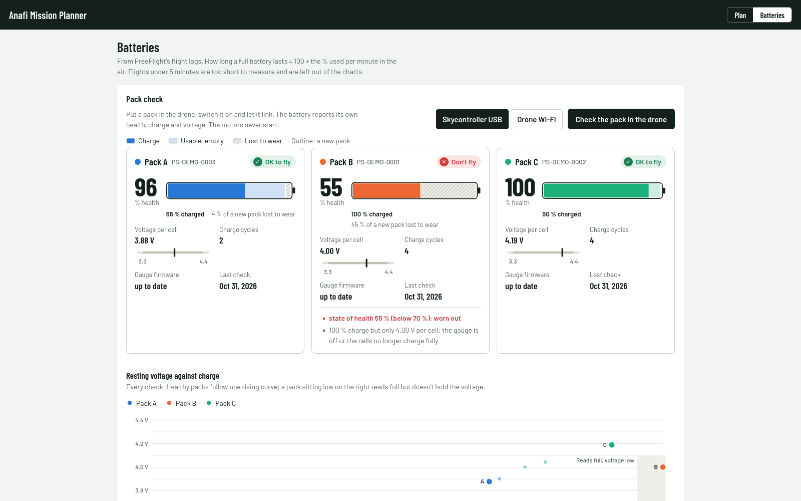
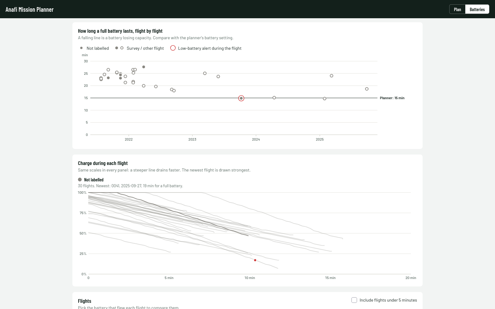
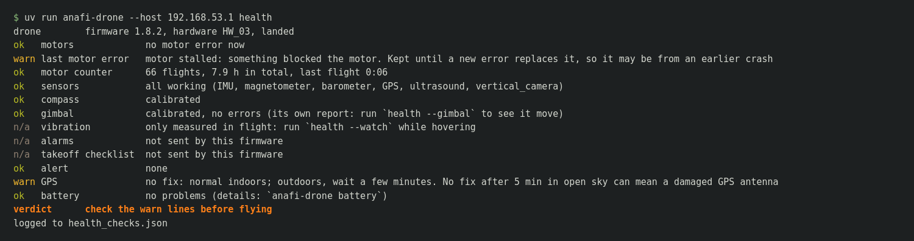

# Anafi Mission Planner

Plan photogrammetry (mapping) missions for the original **Parrot Anafi** on
your computer and fly them, now that Pix4Dcapture is gone.



> [!CAUTION]
> **Experimental. Use at your own risk.** No mission made with this tool has
> finished successfully yet: the only real one crashed
> ([what happened](#what-happened-on-the-first-field-test)). The software comes
> "as is", without warranty ([LICENSE](LICENSE)). You are the pilot: follow your
> local rules and keep the controller in hand, ready to take over.

## Why

Pix4Dcapture left the app stores in 2023, and Pix4D's newer apps don't support
the original Anafi. The drone still flies autonomous MAVLink flight plans, so
this project plans the survey grid and gets it onto the drone, in one of two
ways:

1. **With FreeFlight 6 (no laptop in the field).** Plan on the computer, copy
   the plans to FreeFlight 6 on an iPhone over USB, and fly from the phone as
   usual.
2. **From a Linux laptop.** Upload the plan to the drone and start, watch and
   stop it through the Skycontroller, using Parrot's Olympe SDK.

## What it does

- **Plan on a map:** draw the area on satellite imagery, set the takeoff point,
  pick altitude and speed. Flight time, photo count and batteries update as you
  go. Large areas are split into one flight per battery.
- **Safe climb and descent:** every mission climbs straight up over the takeoff
  point and comes straight down, over home or where it lands. It never changes
  altitude while travelling sideways, and a test checks every kind of mission
  for it.
- **Send to FreeFlight 6** in one click, over the iPhone's USB cable (no iCloud).
- **Your own imagery:** Esri satellite or OpenStreetMap, your own orthophotos
  (e.g. from WebODM) and WMS layers. Maps you've viewed work offline.
- **Battery health:** how long each pack really lasts, from FreeFlight's flight
  logs, and a ground check of what each pack reports about itself.
- **Drone health check** after a crash or a repair, including a photo test that
  proves the gimbal really moves.
- **Laptop flight control:** pre-flight checks, live telemetry, one-key return
  home, pause and stop.

## Status

| Part | State |
|---|---|
| Planner, `.mavlink` writer, time and battery estimate | ✅ checked against real Pix4Dcapture flights |
| Upload to the drone over HTTP | ✅ works on the real drone (fw 1.8.2) |
| FreeFlight 6 transfer | ✅ FreeFlight lists and opens the plans · ⚠️ the first flight crashed; fixed and flown in the simulator, not yet on a real drone |
| GUI: plan, missions, map layers, batteries | ✅ |
| Battery and drone health checks | ✅ ground checks run on the real drone |
| Laptop flight control (Olympe) | 🔧 built; start, pause, stop and return home await a field test |
| Real survey and overlap tuning | 🙋 help wanted |

### Tested in Parrot's simulator

Missions, uploads and flight control also run in [Parrot Sphinx](docs/simulator.md),
which runs the Anafi's real firmware (1.10.4; real drones are on 1.8.2) in a 3D
world:

**Laptop path** (`anafi-drone fly`, our `.mavlink`, photos by distance):

| Test | Result |
|---|---|
| Tiny mission: takeoff, vertical climb, one waypoint, land | ✅ flown end to end |
| Pause, resume, stop, return home | ✅ each one does what `fly`'s keys promise |
| 7-line survey with distance-triggered photos | ✅ 63 photos at the planned spacing and overlap, camera straight down, 3:00 flown vs 3:20 estimated |
| Pause halfway along a line, then resume | ✅ `fly` switches the photos back on for the rest of the line: 72 photos, 9 on every line, none missed |

**Phone path** (Send to FreeFlight, flown from FreeFlight 6, photos by time):

| Test | Result |
|---|---|
| 8-line survey sent from the GUI | ✅ vertical climb and descent over home, lines at the planned altitude |
| Camera set by the plan itself | ✅ tilts straight down and takes photos, whatever the app's camera control says: 114 photos at −90°, 81 % front overlap |
| Taking over with the sticks | ✅ the plan pauses at once and you fly it; resume (play) carries on, but the drone doesn't restart the photos |
| Finish the rest with "Start at line" | ✅ flies only the remaining lines with the same grid: lines 4–6, 26 photos |
| Repeating photo commands in the plan, to restart photos after a resume | ❌ jams the camera (skipped lines, 20 s stalls), so plans start photos once |

The full list, with what each test taught us, is in
[docs/simulator.md](docs/simulator.md#results-so-far-sphinx-2252-2026-11-03-to-04).

It caught problems before they reached a real drone: the tiny test mission
climbed on a slant (the cause of the first crash), `fly` uploaded to the wrong
address, FreeFlight plans filmed video with the camera level, and photos stayed
off after a resume. All are fixed, except that FreeFlight plans still can't
restart photos after a resume: "Start at line" is the way round it. See [docs/simulator.md](docs/simulator.md)
to run it yourself.

> **Help wanted.** The author's drone was damaged in the first field test, so
> testing has stopped. If you have a working original Anafi, issues and pull
> requests are welcome. **A donated Anafi** (unused, or damaged with good
> gimbal and arms, for parts) would let testing continue: please
> [open an issue](https://github.com/GuiAlDuS/anafi-mission-planner/issues/new)
> (no addresses or personal details there; we'll move to a private channel).

## Install

You need [uv](https://docs.astral.sh/uv/); it installs the right Python for you.

```bash
git clone https://github.com/GuiAlDuS/anafi-mission-planner.git
cd anafi-mission-planner
uv sync               # planning, GUI, FreeFlight transfer, battery logs
uv sync --all-extras  # also your own orthophotos, and on x86_64 Linux the
                      # flight control and pack check (Olympe)
```

Planning runs anywhere Python does, macOS on Apple Silicon included.

| For | You also need |
|---|---|
| FreeFlight path | an iPhone with FreeFlight 6; on the computer `libimobiledevice` and `usbmuxd` (tested on Linux) |
| Laptop path, pack and health checks | x86_64 Linux (Olympe has no other builds) |
| `anafi-plan analyze` | `exiftool` |

Drone: original Anafi (4K), firmware 1.8.2, Skycontroller 3.

## Plan and fly with FreeFlight 6

```bash
uv run anafi-gui
```

1. **Plan:** draw the area (or load a GeoJSON), set the takeoff point, pick
   altitude and speed, and check flight time, photos and batteries.
   Put the takeoff point **exactly where you'll take off**, with open sky
   above: the drone climbs straight up over that point. The altitude is above
   the takeoff point, so mind your legal height limit over lower ground.
2. **Save:** name the mission and press **Save mission**. Saved missions can be
   reopened and edited.
3. **Send:** plug in the iPhone (unlock it, tap "Trust" the first time) and
   press **Send to FreeFlight**.
4. **On the phone:** restart FreeFlight 6, open the plan in Flight Plan mode
   and start it. The plan points the camera down and takes the photos by
   itself.
5. **After flying:** in the **Batteries** tab, press "Copy new logs from
   iPhone" and pick the battery that flew each flight.

FreeFlight plans end hovering 5 m above the takeoff point: land with the
controller.

Photos are triggered by **time** here (every N seconds, from the planned
spacing and speed); the laptop path below triggers them by **distance** (GPS
lapse). [The two paths compared](docs/how_it_works.md#two-ways-to-fly-two-ways-to-take-photos).

**If you take over:** pushing a stick pauses the plan and gives you control.
Play resumes the route, but the drone doesn't restart the photos. Return home
instead, then open the mission, set **Finish an interrupted survey → Start at
line** to the line you were on and send it again: it flies the same grid from
that line on, saved as `name_from_line_N` next to the whole survey.



More: [map, drawing and editing](docs/guide.md#the-map) ·
[FreeFlight import details](docs/freeflight_import.md)

## Fly from a Linux laptop

Plug the Skycontroller 3 into the computer with a USB **data** cable. The drone
is reached through it:

```bash
sudo ip route add 192.168.42.1/32 via 192.168.53.1   # once per plug-in
uv run anafi-drone --host 192.168.53.1 status         # battery, GPS, readiness
uv run anafi-drone --host 192.168.53.1 fly out/<name>/flight_1.mavlink
```

`fly` uploads the plan if needed and refuses to start without a GPS fix, a
home point, enough battery, or if the mission exceeds the drone's limits. Then
it asks you to type `yes`. While flying: `r` return home, `p` pause/resume,
`s` stop (hover), `l` land, `q` leave the view. Photos are triggered by **distance** (GPS
lapse) and switched on for each line. After `p` pause and `p` resume, `fly`
switches them back on for the rest of the paused line, so nothing is missed.

Start with a tiny test mission (takeoff, vertical climb, one waypoint, land):

```bash
uv run anafi-plan tiny "HOME_LAT,HOME_LON" "WP_LAT,WP_LON" --alt 10 -o out/tiny.mavlink
```

More: [upload and fly](docs/guide.md#upload-to-the-drone-laptop-path) ·
[field test procedure](docs/step3_field_test.md)

## Map layers

Pick Esri satellite or OpenStreetMap, and add your own orthophotos or WMS
layers on top. A note shows when the image was taken, so you can spot old
imagery before planning over new trees or wires.



More: [map layers](docs/guide.md#map-layers)

## Batteries

The **Batteries** tab reads FreeFlight's flight logs (every flight since 2021,
Pix4Dcapture flights included) and shows how long a full charge lasts per pack,
flight by flight. With a pack in the drone (x86_64 Linux), **Check the pack in
the drone** reads its health, charge and voltage and says "OK to fly" or
"Don't fly". Motors never start.





The planner assumes **15 minutes** per battery by default. Packs age: measure
yours and plan with each pack's own figure.

More: [the Batteries tab](docs/guide.md#the-batteries-tab) ·
[battery commands](docs/guide.md#battery-health-check-on-the-ground)

## Health check after a crash

```bash
uv run anafi-drone --host 192.168.53.1 health            # on the ground, motors off
uv run anafi-drone --host 192.168.53.1 health --gimbal   # prove the camera really tilts
uv run anafi-drone --host 192.168.53.1 health --watch    # then while you hover by hand
```



Don't trust the gimbal's own report: after the first crash it said
"calibrated, no errors" while its tilt motor was dead. Only `--gimbal`'s two
photos showed it. Inspect propellers, arms and motors by eye as well.

More: [what each check reads](docs/guide.md#drone-health-check-after-a-crash-or-a-repair)

## What happened on the first field test

1. **The mission climbed on a slant.** The plans then started at the first
   survey line, so the drone climbed diagonally toward it and hit branches near
   the takeoff point. *Fixed:* missions now climb and descend vertically over
   the takeoff point.
2. **The next takeoff broke an arm.** It had cracked in the crash but looked
   fine. *Lesson:* inspect after any impact; `anafi-drone health` came out of
   this.
3. **The gimbal lied** about being fine (see above). *Lesson:* test that it
   moves.

## Safety

- Fly in an open area, within line of sight, following local rules (many
  countries limit altitude to 120 m / 400 ft).
- Try every new feature on a tiny mission first.
- Keep the Skycontroller in hand. Take over if the drone drifts sideways during
  the climb.
- Take off exactly on the planned takeoff point, with open sky above.
- Check the battery estimate and leave margin for wind.
- Wait for a GPS fix and home point before starting.
- After any impact, inspect the drone and run `anafi-drone health` before
  flying again.

The drone's own failsafes (low battery and lost link return home) stay active,
but they don't replace supervision.

## Documentation

- [User guide](docs/guide.md): the map, layers, Batteries tab, every command
- [How it works](docs/how_it_works.md): hardware findings, mission files, time
  model, code layout, tests
- [Simulator](docs/simulator.md): test missions in Parrot Sphinx, results so far
- [FreeFlight import](docs/freeflight_import.md) ·
  [field test procedure](docs/step3_field_test.md) ·
  [upload test](docs/step2_upload_test.md)
- [Release checklist](docs/RELEASE_CHECKLIST.md) ·
  [standalone program plan](docs/packaging.md)

## Roadmap

- Field test: a tiny mission, then a small survey with GPS lapse photos (help
  wanted).
- FreeFlight 6 on Android, and iPhone transfer on macOS and Windows.
- A standalone program: download, double-click, plan.
- A Fly tab in the GUI.
- Pack check without Olympe, so it works on macOS and Windows.

## References

- [Olympe SDK](https://developer.parrot.com/docs/olympe/) ·
  [source](https://github.com/Parrot-Developers/olympe)
- [Parrot flight plan MAVLink commands](https://developer.parrot.com/docs/mavlink-flightplan/messages_v1.html)
- [Parrot web server upload API](https://developer.parrot.com/docs/webserver-api/module_upload.html)
- [Parrot forum: flight plans with Olympe](https://forum.developer.parrot.com/t/flightplan-with-olympe/9541)
- [anafi-ai-survival-kit](https://github.com/mgr098/anafi-ai-survival-kit)
- [libimobiledevice](https://libimobiledevice.org/)

## Licence

BSD-3-Clause, see [LICENSE](LICENSE). Vendored: Leaflet (BSD-2-Clause) and the
Barlow fonts (SIL Open Font License), with their licences in `ui/static/vendor/`.

Not affiliated with Parrot or Pix4D. Parrot's repair manuals for the Anafi are
on [Parrot's support site](https://www.parrot.com/en/support/anafi/how-to-repair-my-anafi-series-drone).
